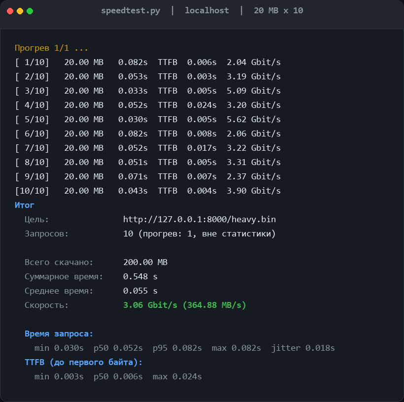
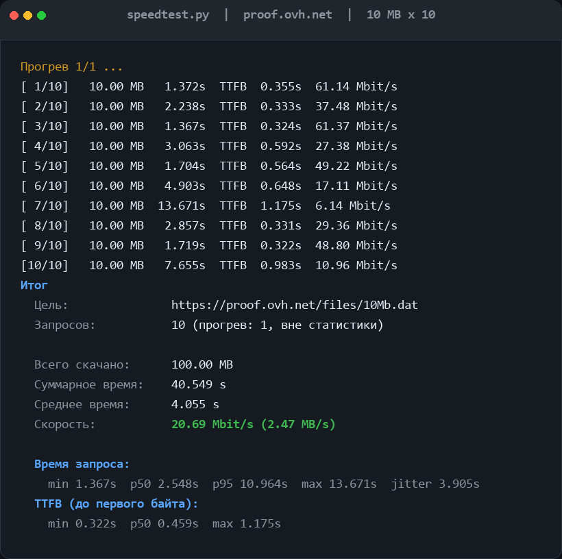

# honest-speedtest

Консольный замер скорости скачивания по HTTP: N последовательных запросов,
полное вычитывание тела каждого ответа, честная агрегация метрик.

Без зависимостей. Python 3.9+.

```
python speedtest.py https://example.com/heavy.jpg
```

---

## Что делает

1. Принимает адрес (URL) тяжёлого ресурса.
2. Делает `--warmup` прогревочных запросов, которые **не попадают** в статистику.
3. Делает `--requests` (по умолчанию 10) последовательных запросов.
4. Каждый запрос дожидается **полного тела ответа**, байты суммируются по факту.
5. Печатает среднее время запроса, суммарный объём и скорость скачивания.

## Требования

- Python 3.9 или новее (проверено на 3.15).
- Сторонних библиотек нет: только стандартная библиотека.

## Запуск: замер скорости

```bash
git clone https://github.com/Saterik/test-script.git
cd test-script

# базовый прогон: 10 запросов, прогресс и итог
python speedtest.py https://proof.ovh.net/files/10Mb.dat

# свои параметры
python speedtest.py https://proof.ovh.net/files/10Mb.dat -n 20 --timeout 15

# машинный вывод
python speedtest.py https://proof.ovh.net/files/10Mb.dat --json
```

Нужен только Python 3.9+. Зависимостей нет.

## Запуск: локальный тестовый сервер (без интернета)

В комплекте есть сервер, который генерирует тяжёлый файл и раздаёт его только
по loopback. Никакие другие файлы проекта наружу не отдаются.

```bash
# терминал 1: поднять сервер (создаст testdata/heavy.bin на 20 MB)
python serve_test_file.py --port 8000 --size-mb 20

# терминал 2: прогнать замер
python speedtest.py http://127.0.0.1:8000/heavy.bin
```

`testdata/` добавлен в `.gitignore`, так что файл не попадёт в репозиторий.
Сервер также отвечает на `/health` → `200 ok` и не засоряет лог обрывами
соединения (`WinError 10053`), которые случаются при прерванном скачивании.

## Опции

| Опция | По умолчанию | Значение |
|---|---|---|
| `url` (позиционный) | — | адрес для скачивания (обязателен) |
| `-n`, `--requests` | `10` | число замеров |
| `--warmup` | `1` | прогревочные запросы вне статистики |
| `--timeout` | `30` | таймаут одного запроса, секунды |
| `--retries` | `2` | повторы на транзиентных ошибках (5xx, 408, 429, сеть) |
| `--json` | выкл. | JSON в stdout, прогресс уходит в stderr |
| `--no-color` | выкл. | отключить ANSI-цвета |
| `--version` | — | версия |

Коды возврата: `0` — успех, `1` — ошибка запроса, `2` — ошибка аргументов,
`130` — прервано с клавиатуры.

## Единицы измерения

В выводе скорость показывается одновременно в двух системах:

- **Mbit/s** (мегабит в секунду) — `10^6` бит в секунду. Так меряют каналы
  провайдеры и speedtest.net.
- **MB/s** (мегабайт в секунду) — `1024^2` байт в секунду. Так меряют файлы.

Соотношение: `1 MB/s = 8.388 Mbit/s` (не ровно 8, потому что мегабайт — это
`1024^2`, а не `10^6`). Скорость считается как

```
скорость = суммарные полученные байты / суммарное время всех замеров
```

Это throughput по определению. Оно **не равно** среднему из скоростей отдельных
запросов: среднее от средних даёт неверный результат, когда запросы разного
размера или разной длительности. Подробности — в тесте
`test_throughput_is_total_bytes_over_total_time`.

## Как считаются метрики

- **Время запроса** — от `time.perf_counter()` перед открытием URL до момента,
  когда прочитан последний байт тела. Монотонные часы, не `time.time()`.
- **Объём** — сумма длин реально прочитанных чанков (64 KB), а не
  `Content-Length`, который может отсутствовать или врать.
- **`Accept-Encoding: identity`** — сжатие отключено намеренно, чтобы мерить
  реальный трафик, а не сжатый поток.
- **Warmup** — первый запрос всегда медленнее из-за DNS, TCP и TLS. Он
  выполняется, но исключается из статистики.
- **TTFB** — время до первого полученного байта.
- **p50 / p95** — перцентили с линейной интерполяцией.
- **jitter** — стандартное отклонение времени запросов.

## Пример вывода

### Loopback: 20 MB × 10 (локальный сервер)



<details>
<summary>Тот же вывод текстом</summary>

```text
Прогрев 1/1 ...
[ 1/10]   20.00 MB   0.082s  TTFB  0.006s  2.04 Gbit/s
[ 2/10]   20.00 MB   0.053s  TTFB  0.003s  3.19 Gbit/s
[ 3/10]   20.00 MB   0.033s  TTFB  0.005s  5.09 Gbit/s
[ 4/10]   20.00 MB   0.052s  TTFB  0.024s  3.20 Gbit/s
[ 5/10]   20.00 MB   0.030s  TTFB  0.005s  5.62 Gbit/s
[ 6/10]   20.00 MB   0.082s  TTFB  0.008s  2.06 Gbit/s
[ 7/10]   20.00 MB   0.052s  TTFB  0.017s  3.22 Gbit/s
[ 8/10]   20.00 MB   0.051s  TTFB  0.005s  3.31 Gbit/s
[ 9/10]   20.00 MB   0.071s  TTFB  0.007s  2.37 Gbit/s
[10/10]   20.00 MB   0.043s  TTFB  0.004s  3.90 Gbit/s

Итог
  Цель:               http://127.0.0.1:8000/heavy.bin
  Запросов:           10 (прогрев: 1, вне статистики)

  Всего скачано:      200.00 MB
  Суммарное время:    0.548 s
  Среднее время:      0.055 s
  Скорость:           3.06 Gbit/s (364.88 MB/s)

  Время запроса:
    min 0.030s  p50 0.052s  p95 0.082s  max 0.082s  jitter 0.018s
  TTFB (до первого байта):
    min 0.003s  p50 0.006s  max 0.024s
```

</details>

### Интернет: 10 MB × 10 (proof.ovh.net)



<details>
<summary>Тот же вывод текстом</summary>

```text
Прогрев 1/1 ...
[ 1/10]   10.00 MB   1.372s  TTFB  0.355s  61.14 Mbit/s
[ 2/10]   10.00 MB   2.238s  TTFB  0.333s  37.48 Mbit/s
[ 3/10]   10.00 MB   1.367s  TTFB  0.324s  61.37 Mbit/s
[ 4/10]   10.00 MB   3.063s  TTFB  0.592s  27.38 Mbit/s
[ 5/10]   10.00 MB   1.704s  TTFB  0.564s  49.22 Mbit/s
[ 6/10]   10.00 MB   4.903s  TTFB  0.648s  17.11 Mbit/s
[ 7/10]   10.00 MB  13.671s  TTFB  1.175s   6.14 Mbit/s
[ 8/10]   10.00 MB   2.857s  TTFB  0.331s  29.36 Mbit/s
[ 9/10]   10.00 MB   1.719s  TTFB  0.322s  48.80 Mbit/s
[10/10]   10.00 MB   7.655s  TTFB  0.983s  10.96 Mbit/s

Итог
  Цель:               https://proof.ovh.net/files/10Mb.dat
  Запросов:           10 (прогрев: 1, вне статистики)

  Всего скачано:      100.00 MB
  Суммарное время:    40.549 s
  Среднее время:      4.055 s
  Скорость:           20.69 Mbit/s (2.47 MB/s)

  Время запроса:
    min 1.367s  p50 2.548s  p95 10.964s  max 13.671s  jitter 3.905s
  TTFB (до первого байта):
    min 0.322s  p50 0.459s  max 1.175s
```

</details>

Второй прогон шёл в нестабильной сети: отдельные запросы растянулись до
13.7 секунды, отсюда jitter 3.9s и p95 10.9s. Именно поэтому инструмент
показывает распределение, а не только среднее.

Цифры на loopback (гигабиты) — это скорость памяти и диска, а не интернета.
Реальную скорость канала показывает прогон по внешнему адресу.

## Скриншоты и замеры

Все артефакты реальных прогонов лежат в папке [`docs/`](docs/):

| Файл | Что это |
|---|---|
| [`docs/screenshot-localhost.png`](docs/screenshot-localhost.png) | скриншот прогона 20 MB × 10 на localhost |
| [`docs/measurements/localhost.txt`](docs/measurements/localhost.txt) | текстовый вывод того же прогона |
| [`docs/screenshot-internet.png`](docs/screenshot-internet.png) | скриншот прогона 10 MB × 10 в интернет |
| [`docs/measurements/internet.txt`](docs/measurements/internet.txt) | текстовый вывод того же прогона |

## Верификация корректности

- **15 unit-тестов** на `pytest`, все проходят. Тесты детерминированные: в
  потоке поднимается локальный `http.server` с известным размером полезной
  нагрузки.
- Проверяется, что число полученных байт **точно** совпадает с отправленным телом.
- Проверяются редиректы и HTTP-ошибки (500 → исключение, без тихого успеха).
- Отдельный тест фиксирует определение throughput: `Σбайт / Σвремя`, а не
  среднее от средних скоростей.
- Отдельные тесты на перцентили и форматирование единиц.
- CLI проверяется через `--json`: количество замеров и суммарный объём.

Сверка с внешним ориентиром: абсолютные цифры зависят от выбранного узла, CDN
и времени суток, поэтому сравнивать нужно на одном канале. Команда для
воспроизведения:

```bash
python speedtest.py https://proof.ovh.net/files/10Mb.dat -n 10
```

Здесь важнее не совпадение с speedtest.net до последнего бита, а стабильность и
объяснимость результата при повторных прогонах.

## Ограничения

Это честный инструмент, поэтому вот чего он **не** умеет:

- **Один поток, одно соединение на запрос.** Не насыщает канал на гигабитных
  тарифах и не измеряет throughput при нескольких параллельных потоках.
- **Новое TCP/TLS-соединение на каждый запрос.** Handshake входит в `elapsed`.
  Для коротких файлов это занижает скорость; для тяжёлых — влияние мало.
- **Нет HTTP/2 и HTTP/3**, нет мультиплексирования. Только HTTP/1.1 через
  `urllib`.
- **Не измеряет RTT отдельно.** TTFB — это сумма сети, сервера и старта тела;
  чистый round-trip не выделяется.
- **Зависит от сервера.** Медленный или нагруженный узел даст низкую цифру, и
  это не про ваш канал.
- **Loopback — не интернет.** Локальный прогон проверяет корректность кода, но
  показывает скорость диска и памяти, а не сети.

## Что бы я добавил в проде

- Параллельные потоки (`--concurrent N`) и сравнение с последовательным режимом.
- Переиспользование соединения (keep-alive) и поддержку HTTP/2.
- Несколько зеркал, медиана между ними и отбрасывание выбросов.
- Отдельный замер RTT через время TCP-handshake, `TCP_INFO` на Linux.
- Схему JSON и экспорт в Prometheus для регулярных замеров.
- Прогресс-бар и TUI для длинных файлов.

## Структура проекта

```
speedtest.py              # основной CLI-скрипт
serve_test_file.py        # локальный сервер с тяжёлым файлом
tests/test_speedtest.py   # 15 тестов на pytest
docs/                     # скриншоты и замеры
  screenshot-localhost.png
  screenshot-internet.png
  measurements/
    localhost.txt
    internet.txt
pyproject.toml            # pytest / ruff / mypy
.github/workflows/ci.yml
README.md
LICENSE
```

## Тесты, линт, типы

```bash
pip install pytest ruff mypy
python -m pytest
python -m ruff check speedtest.py serve_test_file.py tests
python -m mypy speedtest.py
```

CI (`.github/workflows/ci.yml`) прогоняет всё это на Python 3.9, 3.11 и 3.12.


## Лицензия

MIT. См. `LICENSE`.
